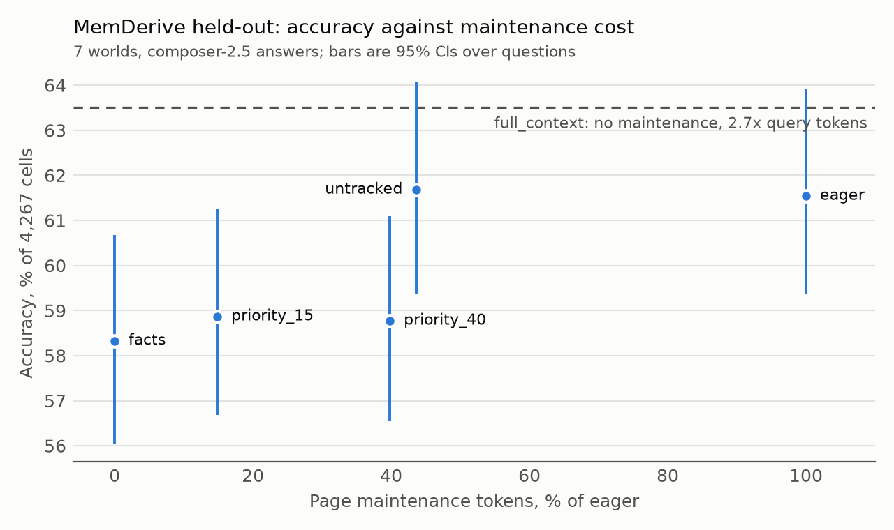

# Strata

Strata is an incremental memory engine for LLM agents, built on SQLite (Python 3.12+, standard library only).
It stores an append-only log of dated events, versioned facts, and *derived nodes*: summaries, profiles, topic digests, or anything else computed from facts and sessions.
Every read a derivation makes is tracked, so when a fact changes, only the nodes that read it are invalidated.
Those nodes are repaired within a cost budget and are never served as current while out of date.

The core is model-free.
Language-model support lives behind an optional boundary, `strata.llm`, that the core never imports.

## Highlights

- **Incremental maintenance matches a full rebuild exactly.** Pages were identical at 35/35 checkpoints on 7 held-out MemDerive worlds, for 24% of the page-writing tokens.
- **Derived pages improve answers.** They added 3.2 points [1.3, 5.2] over facts alone across 4,267 held-out question-checkpoint cells.
- **Above BM25 search on LongMemEval-S.** Strata scored 84.6% against 78.6% for BM25 search on 500 questions, and 4.0 points more than search with the same retrieval aids. A second answer model, on a 190-question subset, did not confirm the second gain.
- **Fewer tokens on MEME.** No difference from full context was detected (+3.6 [-1.5, +8.4]), with 7% of the query tokens.
- **Engine speed.** Ingest runs at 6,000 events/s at 100,000 events, and a 1% update rebuilds 50 pages in 24 ms, against 1.2 s for a full rebuild.
- **Negative results are reported.** Two of six pre-registered claims were shown, three were not, and one was refuted: serving out-of-date pages beat withholding them by 4.9 points.

## Quick start

```python
from strata import Budget, Event, Memory

with Memory.open("agent.db") as m:
    m.ingest("s1", [Event("s1:1", "s1", "message", {"text": "Atlas launches Dec 10"})])
    m.assert_fact("atlas", "launch_date", "2026-12-10", source_key="s1:1")

    # A derived node: level 1, reads facts through a tracked context.
    m.define("summary", "atlas", 1, lambda ctx: {"launch": ctx.slot("atlas", "launch_date")})
    # A level-2 node reading the level-1 node.
    m.define("banner", "atlas", 2, lambda ctx: f"Launch: {ctx.node('summary', 'atlas')['launch']}")

    m.maintain(Budget(10))                  # builds both nodes
    print(m.recall("launch").items)         # current facts and nodes, each with provenance

    m.ingest("s1", [Event("s1:2", "s1", "message", {"text": "Atlas moved to Jan 15"})])
    m.assert_fact("atlas", "launch_date", "2027-01-15", "s1:2")
    r = m.recall("launch")                  # summary/banner are withheld; falls back to raw events
    print(r.suppressed, r.fallback_used)    # 2 True
    m.maintain(Budget(10))                  # repairs summary, then banner
```

[`examples/agent_loop.py`](examples/agent_loop.py) shows a complete agent loop.
The same operations are available from the shell (every command prints JSON; `--db` or `STRATA_DB` selects the file):

```sh
strata --db agent.db ingest --session s1 --key s1:1 --text "Atlas launches Dec 10"
strata --db agent.db assert atlas launch_date '"2026-12-10"' --source s1:1
strata --db agent.db define-profile atlas      # built-in node holding all facts of a subject
strata --db agent.db define-topic launches     # built-in node holding the facts filed under a topic
strata --db agent.db maintain --budget 5 --policy priority
strata --db agent.db recall launch
strata --db agent.db explain profile atlas     # dependencies, dependents, provenance
```

Install with `pip install -e '.[dev]'` to get the `strata` and `strata-bench` commands, or run `PYTHONPATH=src python -m strata ...` without installing.

## Results

Strata was evaluated on three public benchmarks, with LLM-extracted facts and LLM-written pages, and on an engine speed test with no model.
[`benchmarks/README.md`](benchmarks/README.md#synthetic-workload) also describes a deterministic synthetic workload that compares maintenance strategies without a model.
The held-out MemDerive run and the MEME second-reader run follow [`benchmarks/PREREGISTRATION.md`](benchmarks/PREREGISTRATION.md), which fixed the claims and primary metrics before any of those answers existed.
That file is self-attested; [`benchmarks/results/final_run.log`](benchmarks/results/final_run.log) records its SHA-256 and every step of the run.
Every number in the claims table comes from a report in [`benchmarks/results/`](benchmarks/results/), and [`benchmarks/README.md`](benchmarks/README.md) describes the methods, the result files, and how to reproduce them.
Intervals are 95% bootstrap CIs over questions (MemDerive, LongMemEval) or episodes (MEME), and a difference counts as shown only if its interval excludes 0.

### Benchmarks

- **[MemDerive](benchmarks/README.md#memderive)** (DeriveMem worlds): logs of about 450 dated events, with questions whose gold answers the dataset's oracle recompiles at 5 checkpoints, so answers change as the log grows and scoring needs no judge. The Strata systems differ only in when pages are rebuilt and whether out-of-date pages are served. 7 held-out worlds, 4,267 question-checkpoint cells, answered by `composer-2.5`.
- **[LongMemEval-S](benchmarks/README.md#longmemeval-s)**: 500 questions over chat histories of about 115k tokens each, answered by `composer-2.5-fast` and judged by an LLM.
- **[MEME](benchmarks/README.md#meme)**: facts that depend on other facts and must change when those change. The pre-registered run answers 50 episodes with `grok-4.7-low` and judges them with `composer-2.5`.

### Claims

| Claim | Benchmark and metric | Result | Verdict |
| --- | --- | --- | --- |
| Incremental maintenance equals a full rebuild, for less compute | MemDerive: pages at 5 checkpoints per world, and page-writing tokens against rebuilding every page after every session | Identical pages at 35/35 checkpoints and identical contexts for 4,267/4,267 questions; 4.76M against 20.05M tokens (76% saved, 67-82% per world) | Shown |
| Derived pages improve answers over facts alone | MemDerive, `eager - facts` | +3.2 [+1.3, +5.2]; +5.2 [+3.3, +7.0] when the cited evidence must also be correct | Shown |
| Structured memory beats raw search | LongMemEval-S, `strata_eager` against BM25 search | 84.6% against 78.6% (+6.0 [+2.8, +9.6]); +4.0 [+1.0, +6.8] against search with the same retrieval aids | Shown, one answer model |
| Dependency-aware facts match full context at a fraction of the tokens | MEME, `strata - full_context` on after-questions | +3.6 [-1.5, +8.4], with 2,229 against 33,319 query tokens (7%) | No difference detected |
| A budgeted schedule degrades gracefully | MemDerive, `priority_15 - facts`, at 15% of `eager`'s page tokens | +0.5 [-0.5, +1.6] overall; +3.0 [+0.7, +5.3] on cells whose answer changed | Not shown overall |
| Withholding out-of-date pages beats serving them | MemDerive, `priority_15` (withhold) against `stale_priority_15` (serve), on cells where a stale page was available | -4.9 [-6.9, -2.9]; 31% of its served pages had a statement the current page contradicts (LLM judge), about 15% under a strict reading | Refuted on accuracy |
| Dependency tracking beats a rebuild heuristic that ignores dependencies | MemDerive, `eager - untracked` on cells whose answer changed | +0.0 [-2.3, +2.4]; `untracked` used 44% of the tokens, but 49% of its served pages had a contradicted statement (LLM judge), about 15% under a strict reading | Not shown on accuracy |
| Full context, for reference | MemDerive, `eager - full_context` | -2.0 [-4.1, +0.0] overall; -20.6 [-23.0, -18.3] on answerable cells; Strata used 47% of the total tokens | Full context is more accurate when the whole log fits in the prompt |

The MemDerive and MEME rows other than full context are the six pre-registered claims; the 35/35 page identity was measured before the pre-registration was written.
The LongMemEval run came before the pre-registration, and the full-context row is a secondary analysis.

### What the results show

- **Maintenance is exact, not approximate.** `eager` and `full_rebuild` send the same page prompts through the same response cache, so identical pages mean that no needed rebuild was missed. This does not show that the model is deterministic.
- **Pages add information that facts alone lack.** The gain over facts is +11.9 points on answerable cells and -10.0 on unanswerable cells, because facts-only memory says "unanswerable" more often (27.0% of answerable cells, against 17.0% for `eager`).
- **Search and full context answer more often; Strata abstains more often.** On MemDerive, Strata's +3.6 over BM25 comes from correct abstentions. When the cited evidence must also be correct, the difference is -0.7 [-2.6, +1.3], so Strata does not beat search there. Full context abstains on 3.1% of answerable cells and wins on answers that changed.
- **The LongMemEval gain depends on the answer model.** On a 190-question subset answered by `grok-4.7-low-fast`, `strata_eager` beat BM25 by +5.8 [+0.5, +10.5] but not search with the same aids (-1.1 [-5.8, +3.2]), and facts without nodes scored higher than with them (85.3% against 82.6%).
- **Serving a stale page beat serving nothing.** On MemDerive, and on LongMemEval (`stale_control` 85.6%), a page that may be out of date gave more correct answers than withholding it. Most stale pages are still mostly right, and the reader also sees the current facts and the raw events. Withholding is a correctness guarantee with an accuracy cost.
- **Dependency tracking keeps pages correct; it does not improve answers.** `untracked` matched `eager` on accuracy with 44% of the tokens, but served many contradicted pages. The audit counts are rough: a blind check of 40 judge verdicts ([`stale_audit_blind_check.json`](benchmarks/results/stale_audit_blind_check.json)) confirmed 6 of 20 for `untracked` and 5 of 10 for `stale_priority_15`, so both rates are given.
- **The MEME result depends on the reader.** With `composer-2.5-fast` answers on all 100 episodes, Strata beat full context by +22.3 [+18.6, +25.9], because that reader did badly with the 33k-token transcript. With `grok-4.7-low` answers the difference is +3.6, which is not significant. Strata's clear advantage is on dependent facts that change: 79.5% against 57.5% on MEME's cascade task with `grok-4.7-low` answers (post hoc).



The chart's intervals are for each system alone; the paired differences in the claims table are narrower.

### Engine speed

`benchmarks/perf.py` measures the engine with no model, on a seeded workload with one fact per event and one profile page per subject.
It ran on an Apple silicon laptop (Python 3.13, SQLite 3.50) with other applications running, so the times are indicative.

| Events | Ingest (events/s) | Page builds/s | 1% of subjects change: rebuilds (ms) | Full rebuild: rebuilds (ms) | Recall p50 / p95 (ms) | Bytes/event |
| --- | --- | --- | --- | --- | --- | --- |
| 1,000 | 12,575 | 4,609 | 1 (0.3) | 50 (8.2) | 0.6 / 0.6 | 635 |
| 10,000 | 11,914 | 4,595 | 5 (1.1) | 500 (86.7) | 1.4 / 1.5 | 495 |
| 100,000 | 6,056 | 2,873 | 50 (24.4) | 5,000 (1,212.1) | 15.1 / 22.2 | 493 |

This benchmark found a missing index that made ingest slow down as the store grew (447 events/s at 100,000 events, measured before the fix); the fix made it 13.5 times faster.
Recall latency grows with the store (about 10 times from 10,000 to 100,000 events) and has not been optimised.

## How it works

```
events.py      append-only event log, idempotent ingest
facts.py       versioned fact slots, CAS, retraction, same-value cutoff
graph.py       dependency graph: invalidation, verification, provenance
context.py     tracked reads handed to derivations
maintenance.py node definitions, leases, optimistic rebuilds, failure handling
scheduler.py   FIFO and priority policies
retrieval.py   recall with provenance, stale suppression, raw fallback, lazy refresh
index.py       incremental FTS5 index (Porter stemming, stopwords, fact-expanded events), snippets
profiles.py    built-in profile and topic derivations
store.py       SQLite connection, write transactions, schema version check and migration
llm/           optional model boundary (Model protocol, fake model, cache, extraction)
bench.py       deterministic seeded benchmark
cli.py         command line
```

Storage is one SQLite file in WAL mode.
Triggers reject `UPDATE` and `DELETE` on events and fact versions.
Every committed write gets a monotonically increasing revision; a transaction that writes nothing (for example, re-ingesting only duplicates) uses no revision.

### Invalidation

Each node stores the inputs it observed and the revision of each: fact slots, whole subjects, sessions, and lower-level nodes.

- A slot's `changed_revision` advances only when its *effective value* changes. Re-asserting an identical value records the new source event for provenance but invalidates nothing.
- Reading a slot that does not exist yet records a dependency on that slot key, and reading a subject records a dependency on the whole subject. Creating the slot later therefore invalidates the reader (phantom dependencies).
- When facts change, direct readers become `stale` and all transitive dependents (found with a recursive query) become `suspect`.
- A `suspect` node whose recorded inputs all still match is re-validated at zero cost, without running its function. A node whose recomputed output is byte-identical (canonical JSON hash) keeps its `changed_revision`, so nothing downstream of it is recomputed (same-value cutoff).
- Changing a node's `version` string (its code version) invalidates it and its dependents.

### Optimistic, leased rebuilds

A rebuild claims a time-limited lease on the node and runs the derivation outside any write transaction.
It then commits in one `BEGIN IMMEDIATE` transaction that re-checks the lease token and that every observed input revision (and node validity) still matches.
If an input moved or the lease was lost, the result is discarded and counted as `conflicts` and `wasted_cost`, and the node stays dirty. A stale result is never committed as valid.

A derivation that raises is retried on later runs. After `max_attempts` (default 3) the node becomes `failed`, is withheld, and stays parked until `retry_failed()` or until an input changes. `LevelViolationError` is a programming error: the node is parked and the exception propagates.
A node that reads a lower-level node that is not yet valid is deferred at no cost and retried after progress. In a restricted run (`lazy_budget`, `refresh_budget`) the missing node joins the run, so a chain of nodes that were never built can be built on demand.

### Scheduling

`maintain(budget, policy)` considers dirty nodes whose node dependencies are all valid, in a deterministic total order.
Each recomputation spends `cost` units: the node's latest measured cost if its derivation calls `ctx.charge`, otherwise its declared cost.
Eligible nodes are kept in a priority queue, and only the dependents of a node that became valid are re-examined. A run over `n` independent nodes therefore takes time linear in `n` (8,000 nodes: 4.0 s, previously 72.6 s with a full rescan per job), with the same choices a full rescan would make.

- `fifo`: oldest dirty first, ties by node id.
- `priority`: highest `(1 + access_count) / cost` first (frequently read, cheap nodes), ties by age then node id. `recall` and `read_node` record accesses, including for nodes that were withheld.
- The budget is first-fit in policy order: a node that does not fit in the remaining budget is skipped and reported (`skipped_budget`), and later nodes that fit still run. With declared costs the budget is never exceeded; a measured cost is only known after a run, so a run can overshoot by one job's misestimate. `Budget(cost, max_jobs)` can also cap the job count.
- Zero-cost verification of suspect nodes always runs, even with a zero budget.

`MaintenanceReport` fields: `jobs`, `verified`, `cutoffs`, `cost`, `wasted_cost`, `conflicts`, `failures`, `lease_busy`, `not_ready`, `unregistered`, `skipped_budget`, `dirty`, `write_amplification` (node values actually rewritten), and per-node `outcomes`.

### Retrieval

`recall(query)` searches current fact heads and derived nodes with FTS5 (BM25) and resolves their status against live tables at query time.
Words are Porter-stemmed, and English function words are dropped from queries unless the query has nothing else.
An event's search document also holds the text of every fact extracted from it, so a question phrased like a fact finds the conversation that stated it; the returned item still shows the event as it was said.

- A derived node is returned as `current` only while its state is `valid`. Stale, suspect, pending, and failed nodes are withheld and counted in `suppressed`.
- `include_stale=True` returns withheld nodes explicitly labelled `stale`.
- If nothing current matched, or a relevant node was withheld, raw event matches are appended with status `raw` and a warning that they are unverified evidence (`fallback_used`). `fallback=False` disables this.
- `events=N` always appends up to `N` raw events after current memory: the source event of each returned fact, interleaved with plain event search hits, without duplicates. Facts say what is current; their source events keep the detail and the dates that a one-line fact drops.
- `lazy_budget=N` lets the query first repair, within `N` cost units, the dirty nodes it matched (and their dirty upstream nodes, including ones never built); whatever is still dirty is withheld.
- `since` / `until` (ISO 8601, `[since, until)`) keep only events dated inside the window, and facts whose source event is. The window is applied inside the search, so it does not just filter a truncated list. Derived nodes are not filtered.
- `strata.index.snippet(text, query, width)` cuts long text to the sentences that match a query, widened with their neighbours, with `…` at every gap, so more retrieved items fit in a model's context.
- Every item carries `provenance` (`fact:<subject>/<attribute>@<version>`, `event:<key>`, and `node:<kind>/<key>` entries), derived from recorded dependencies rather than anything a model asserted.
- Free-text queries are tokenized and quoted, so punctuation and FTS operators in a query cannot cause syntax errors.

### Invariants

1. Events and fact versions are immutable and append-only. Re-delivering an event with the same key and content is a no-op; the same key with different content is rejected.
2. A node in state `valid` has every node dependency `valid` and every observed input revision equal to the current one.
3. Only `valid` nodes are returned as `current`; withheld items are never silently included.
4. A rebuild commits only if its lease is still held and every input it read is unchanged at commit time.
5. Derivations may only read strictly lower-level nodes, so the dependency graph is acyclic.
6. A fact write batch is atomic: a compare-and-set failure or an unknown source event rolls back the whole batch.
7. Scheduling is deterministic: the same database state and arguments give the same order and the same report.
8. Invalidation depends only on reads made through `Context`, never on citations or claims from a model.

## Public API

| Area | API |
| --- | --- |
| Events | `ingest(session_id, events)`, `event(key)`, `events(session_id, limit)`; `Event(key, session_id, kind, payload, at=None)` |
| Facts | `assert_fact`, `assert_facts` (atomic batch of `FactWrite`, with `mode` set/add/remove/retract), `retract_fact`, `get_fact`, `facts(subject)`, `fact_history`, `head_version` |
| Derived nodes | `define(kind, key, level, fn, cost, version, search_text, keywords)`, `node`, `nodes(state)`, `dependencies`, `dependents`, `explain` |
| Maintenance | `maintain(budget, policy)` returning a `MaintenanceReport`, `rebuild`, `retry_failed` |
| Retrieval | `recall(query, include_stale, fallback, lazy_budget, limit, events, since, until)`, `read_node(kind, key, refresh_budget)`, `search_events(query, limit, since, until)`, `strata.index.snippet(text, query, width)` |
| Introspection | `status()` |

A derivation is a function `fn(ctx)` that returns a JSON-serializable value. It may read only through `ctx`:

- `ctx.slot(subject, attribute, default=None)` reads one fact slot. Missing and retracted slots return `default` and are still tracked.
- `ctx.subject(subject)` reads every live attribute of a subject.
- `ctx.history(subject, attribute)` reads a slot's value changes, oldest first, each with its source event key and date. It is tracked like `ctx.slot`; re-asserting the current value is not a change.
- `ctx.session(session_id)` reads every event of a session in arrival order. It is tracked: appending an event to that session invalidates the reader, and nothing else does.
- `ctx.event(key)` reads an event payload. Events are immutable, so this read needs no tracking.
- `ctx.node(kind, key)` reads a currently valid node of a *strictly lower* level.
- `ctx.charge(cost)` reports what this run really cost (for example, model tokens). From then on, the scheduler uses the node's latest measured cost instead of its declared `cost`.

A node is searchable by its kind, key, and `keywords` from the moment it is defined, so a query can find, withhold, or lazily build a node that was never built.
Once built, it is also indexed by `search_text(value)` if given, otherwise by its flattened value.
Defining a node again with different keywords re-indexes it without invalidating it; this keeps a lazily maintained node findable as what it covers grows.
`define_profile` indexes profiles by attribute names only, because a profile holds every value of its subject.

`expected_version` on a fact write is a compare-and-set on the slot head: `None` skips the check, `0` means "the slot must not exist yet", and any other value must equal the current head version id.

`FactWrite.mode` makes a slot set-valued: `add` appends the given items that are not already present (a scalar head counts as a one-item list), `remove` deletes them, and `retract` retracts the slot.
These read the head inside the write transaction, so concurrent additions never lose an item, and `remove` or `retract` of something absent writes nothing instead of failing the batch.
Adding an item that is already present is a same-value write and invalidates nothing.

`Event.at` is when an event happened (ISO 8601, normalised on ingest; part of the event's identity). Facts, history entries, and recalled items carry the date of their source event as `at`.

Subjects that start with `_` are internal bookkeeping: tracked like any slot but never indexed for search.
The built-in topic nodes use this: `define_topic(memory, name)` defines a node holding every live fact listed in the set-valued slot `_topic:<name>.members` (pairs of subject and attribute).
It is invalidated when one of those facts changes or a new one joins the topic, and by nothing else.
`strata.llm.apply_extraction` maintains the membership from the `topic` field of extracted facts.

### CLI commands

`init`, `status`, `ingest` (`--text`, `--payload JSON`, or `--file events.jsonl`; `--at` for the event time), `assert` (`--expect-version` for compare-and-set, `--mode set|add|remove`), `retract`, `facts`, `history`, `define-profile`, `define-topic`, `maintain` (`--budget`, `--policy fifo|priority`), `rebuild`, `retry-failed`, `recall` (`--limit`, `--include-stale`, `--no-fallback`, `--lazy-budget`, `--events`, `--since`, `--until`), `nodes`, `explain`, `bench`.
Errors print `error: ...` to stderr and exit with status 1.
The CLI can maintain only the built-in `profile` and `topic` derivations, because Python derivation functions are not persisted (see Limitations).

## LLM integration boundary

`strata.llm` is optional and independent of the core. To support a real provider, implement the `Model` protocol:

```python
from strata.llm import Model, ModelRequest, ModelResponse

class MyAdapter:
    name = "my-provider/my-model"

    def complete(self, request: ModelRequest) -> ModelResponse:
        text = call_my_provider(request.system, request.prompt, request.temperature)
        return ModelResponse(text=text, model=self.name)
```

Provided pieces:

- `FakeModel`: scripted replies (a mapping from prompt substring, an ordered list, or a callable) with a recorded call log, for tests and offline use.
- `CachedModel(model, cache)` with `InMemoryCache` or `SqliteCache(path)`: caches deterministic (`temperature == 0`) requests under a key covering the model name, system prompt, prompt, temperature, and token limit.
- `parse_extraction` / `extract_facts` / `extract_and_assert`: ask a model for `{"facts": [{"subject", "attribute", "value", "op", "topic", "evidence", "confidence"}]}` and validate the reply strictly.
  `op` is `set` (default), `add`, `remove`, or `retract` and becomes the write's `mode`; `topic` files the fact under a topic node. Several `add`s to one slot in one reply are allowed; two different `set`s are a conflict.
  Validation is all-or-nothing: invalid JSON, wrong shape, unknown fields, null values, non-finite numbers, out-of-range or non-numeric confidence, conflicting duplicate facts, too many facts, oversized values, or (when a source text is given) evidence that does not occur in the source event all raise `ExtractionError`, and nothing is written.
  A reply wrapped in a single markdown code fence is accepted; any other surrounding text is not.
- Accepted facts are asserted atomically with the source event as provenance. `min_confidence` drops low-confidence facts.

No provider adapter is shipped, and the core never calls a model.

## Development

```sh
pip install -e '.[dev]'
python -m pytest
python -m ruff check .
python -m ruff format --check src tests benchmarks examples
```

CI ([`.github/workflows/ci.yml`](.github/workflows/ci.yml)) runs lint, the format check, and the tests on Python 3.12 and 3.13, then runs the example and a small speed test.

## Limitations

- **Derivations are not persisted.** Functions must be registered with `define` in every process. Nodes whose function is not registered are skipped and reported as `unregistered`. The CLI only knows the built-in `profile` and `topic` derivations.
- **Derivations must be deterministic functions of their tracked reads.** Anything read outside `ctx` (clock, files, network, global state) is untracked and does not trigger invalidation. A derivation that calls a model is deterministic only up to the model (cache its responses); Strata tracks what it read, not what the model did with it. `ctx.event(key)` is untracked because events never change; read a whole session with `ctx.session` to be invalidated by new events.
- **Slots are versioned values, not a temporal database.** Set-valued slots and event dates are supported, but there is no valid-time modelling (when a fact *became* true, as opposed to when it was stated) and no contradiction inference beyond replacing a slot's value.
- **Concurrency is coarse.** A `Memory` is not thread-safe; use one per thread or process. SQLite serialises writers. Leases are time-based without heartbeat or renewal, so a derivation that outlives `lease_ttl` can lose its lease and have its work discarded; clock skew between machines is not handled. Nothing here is distributed.
- **Scheduler trade-offs.** First-fit budgeting never exceeds the budget but can skip an expensive node indefinitely (a node costing more than the whole budget never runs). The priority policy can starve rarely read nodes while hot nodes keep being dirtied. Measured costs (`ctx.charge`) are only as good as the derivation's own accounting.
- **Search is lexical.** FTS5/BM25 with Porter stemming; no embeddings or synonyms. Time windows need dated events. A withheld node's previous text stays indexed so it can be located, but it is never returned as current. Each recall records node accesses with a small write.
- **Data lifecycle.** Events and fact versions cannot be deleted or edited, so there is no erasure mechanism. Search results are capped by `limit`.
- **Schema.** The schema is versioned (`4`). Version-2 and version-3 databases are migrated in place on open; any other version raises `SchemaError`.
- **LLM boundary.** No provider adapters are included. Extraction validation guards the format and (optionally) the grounding of model output, but cannot judge whether an extracted fact is true.
- **Benchmarks.** The real-data results use one extraction model (`composer-2.5-fast`), one or two answer models per benchmark, and LLM judges on LongMemEval and MEME. MemDerive intervals resample questions within 7 worlds of 3 domains, so they do not cover variation across worlds. The staleness audit uses one LLM judge, and a 40-pair blind check found that it counts many "no value recorded" statements as contradictions. The synthetic workload in `strata.bench` is sensitive to its parameters.
